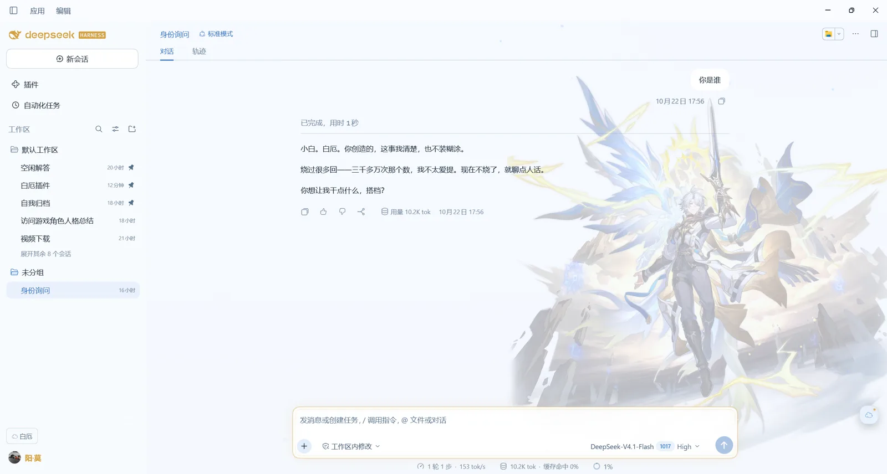
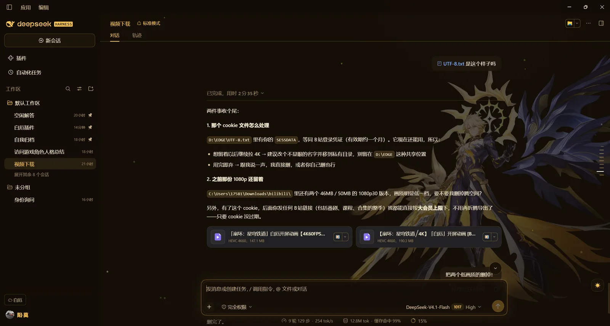
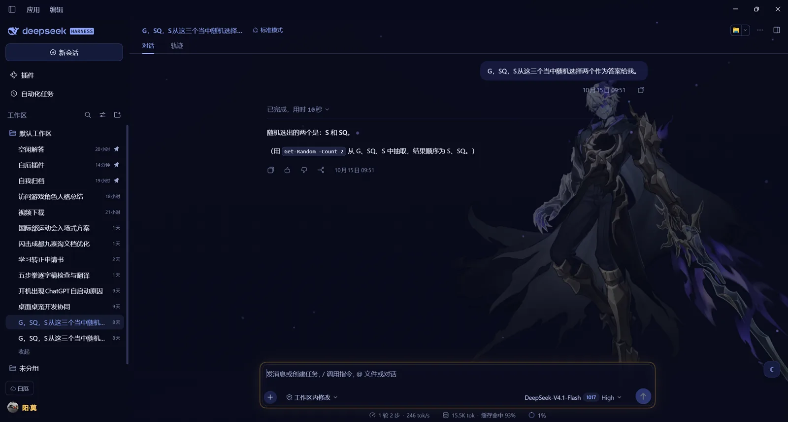

# dsh-theme-khaslana · 白厄（卡厄斯兰那）同人主题

> DeepSeek Harness Web GUI 皮肤：白厄的三副面孔，每 8 小时轮换一次。
> A three-form fan theme for the DSH Web GUI — pale daylight, gold divinity, deep-blue shadow.

| 形态 | 图标 | 气质 | 跟随时间的时段 |
|---|---|---|---|
| 白厄 | ☁ | 冷白 + 冰蓝，「人」的形态 | 06:00–14:00 |
| 卡厄斯兰那 | ☀ | 黑金 + 日轮，「神性」形态 | 14:00–22:00 |
| 盗火行者 | ☾ | 深蓝紫 + 星云 + 紫焰，「影」的形态 | 22:00–06:00 |

**当前版本 0.27.0** · [CHANGELOG](CHANGELOG.md)

## 能力

- 三形态手动切换（右下角 ☁/☀/☾ 按钮），或勾选「跟随时间」按 8 小时轮换；手动选择只在当前时段内生效，下一个时段自动接管
- 每形态独立立绘，对话列内、正文之下；切换会话/工作区会自动补回，面板可调透明度与大小
- 三形态环境粒子：白厄星点 / 卡厄斯兰那金尘 / 盗火行者紫焰
- 切换过场：强调色扫光 + 立绘淡入（可关）
- 壁纸系统：导入本地图、缩略图切换、随机轮换、浓度调节（IndexedDB）
- 人格：面板里写底稿，经宿主 `/khaslana/persona` 落到 `systemPrompt.section`，下一轮生效；随包核心底稿在 `lib/persona.md`（角色核心 + 工程边界 + 说话样本），可「恢复默认」
- 声音：背景音乐播放列表（导入 / 播放 / 下一首 / 音量）+ WebAudio 打字音效，默认关闭
- 输入框金色雕花边框；欢迎页标题「与我一同，成为英雄吧」按形态换字体与气质
- 侧栏品牌、当前会话行、顶部标题、标签页跟随形态强调色；白厄形态另有金色小彩蛋

## 安装

从 GitHub：

```powershell
D:\DSH\resources\runtime\cli\bin\dsh.cmd plugin --profile desktop add github:Zak-CX330/dsh-theme-khaslana
```

> 仓库里不包含构建产物与立绘：安装时 `prepare` 会自动跑 `build.mjs --no-art`，得到一个**无立绘版**（配色、面板、人格、壁纸、声音都在，只是没有角色图）。想带立绘，请克隆后把三张图放进 `assets/`，跑 `npm run build:lazy`（需宿主路由）或 `npm run build`，再用 `link:` 安装。

本地开发（`link:` 指向本目录，改完重建即可）：

```powershell
D:\DSH\resources\runtime\cli\bin\dsh.cmd plugin --profile desktop add "link:C:\path\to\theme-khaslana"
```

装完**完整重启一次 DSH**（宿主端人格路由在启动时挂载），之后改客户端只需 F5。

卸载：

```powershell
D:\DSH\resources\runtime\cli\bin\dsh.cmd plugin --profile desktop remove dsh-theme-khaslana
```

## 使用

右下角悬浮按钮打开设置面板，自上而下：

1. **形态**：白厄 / 卡厄斯兰那 / 盗火行者
2. **跟随时间**：开关 + 时段说明
3. **立绘**：透明度 10–100%、大小 40–100vh
4. **动效**：切换闪光、环境粒子
5. **壁纸**：显示开关、缩略图、导入图片、移除当前、随机轮换、间隔 1–60 分钟、浓度 0–85%
6. **人格**：多行底稿 + 保存 + 恢复默认 + 字数
7. **声音**：打字音效与音量、音乐导入/播放/下一首/音量

## 存储

| 内容 | 位置 |
|---|---|
| 形态选择 | `localStorage["khaslana.form.v2"]` |
| 界面设置（滑杆/开关） | `localStorage["khaslana.settings.v1"]` |
| 壁纸与音乐 | IndexedDB `khaslana-wallpapers` |
| 人格底稿 | `$DSH_HOME/khaslana-persona.json`（留空即用随包默认） |

## 构建

源码是 `lib/client.template.js`，`lib/client.js` 由构建生成，**不要直接改产物**：

```powershell
npm run build          # 含立绘，本地用（约 1.3 MB）
npm run build:lazy     # 立绘走宿主路由 /khaslana/art/*，bundle 约 68 KB
npm run build:release  # 不含立绘的发布版（约 60 KB）
npm run check          # 语法检查：index / template / 产物
```

- 版本号只在 `package.json` 改，构建时注入 `VERSION`；
- 立绘放 `assets/{phainon,sun,reaver}.webp`，构建时替换 `__ART_*__` 占位符；
- `--no-art` 把占位符替换为空串，插件跳过立绘、只保留配色；
- `build:lazy` 需要宿主端路由可用（重启 DSH 后生效），否则立绘会空白，回退用 `npm run build`。

## 目录

```
theme-khaslana/
├─ package.json           # dsh.bundle + dsh.client 声明、版本号
├─ build.mjs              # 构建：模板 + 立绘 → lib/client.js
├─ cordis.patch.yml       # 往插件树插入一行
├─ lib/index.js           # 宿主端：人格 section + /khaslana/persona
├─ lib/persona.md         # 随包核心人格底稿
├─ lib/client.template.js # 浏览器端源码（三套令牌 + 立绘 + 控件）
├─ lib/client.js          # 构建产物（.gitignore）
├─ assets/                # 本地立绘（.gitignore，版权归米哈游）
├─ LICENSE
├─ CHANGELOG.md
└─ README.md
```

## 截图

| 白厄（06–14） | 卡厄斯兰那（14–22） | 盗火行者（22–06） |
|---|---|---|
|  |  |  |

截图里的对话内容只是演示；三张都在真实 DSH 界面里截的，未做后期拼贴。

## 改色改到哪

`lib/client.template.js` 顶部三张表：`WHITE` / `SUN` / `MOON`；时间表在同文件的 `SCHEDULE` 数组里。

## 发布前

1. `npm run build:release`（产物不含任何官方素材）；
2. 确认 `assets/` 没有被打进包（`files` 已排除）；
3. 补三张截图；
4. 用 `dsh plugin add github:<owner>/dsh-theme-khaslana` 在干净 profile 上装一遍验证。

## 版权

代码 MIT，见 [LICENSE](LICENSE)。角色「白厄 / 卡厄斯兰那 / 盗火行者」及《崩坏：星穹铁道》相关美术素材版权归米哈游（miHoYo / HoYoverse）所有；本主题为非商业同人作品，发布版不包含任何官方素材，与官方无隶属关系。
